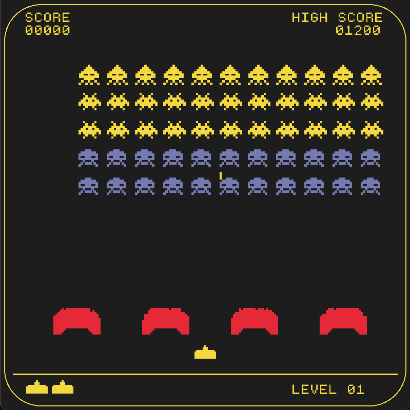

# Space Invaders

A retro arcade game built with **C++17** and **raylib**, inspired by the classic Space Invaders. Move your spaceship, dodge enemy fire, and take on a descending alien formation in a pixel-art battlefield.

<p align="center">
  
</p>

## Gameplay

Start with three lives and face a formation of 55 aliens. Use the four bunkers for cover, but watch your shots: both player and enemy lasers can destroy their blocks. A mystery ship periodically crosses the screen, offering an extra scoring opportunity.

- **Three alien types** worth 100, 200, and 300 points.
- **Mystery ship** worth 500 points, spawning at randomized intervals.
- **Destructible cover** built from individual blocks.
- **Music and sound effects** for shooting and explosions.
- **Score and lives display**, with local high-score storage in `highscore.txt`.
- **Restart after game over** without relaunching the application.

The current version features a single alien formation; automatic wave progression is not implemented yet.

## Controls

| Key | Action |
| --- | --- |
| Left / Right arrow | Move the spaceship |
| Space (hold) | Fire lasers |
| Enter | Restart after game over |
| Escape | Exit the game |

## Technical highlights

- **C++17 and the standard library:** classes, vectors, iterators, and file streams to manage gameplay objects and saved scores.
- **Game loop:** input, updates, and rendering are separated, with a target of 60 FPS.
- **Collision handling:** rectangle-based checks connect projectiles, aliens, the player, and individual bunker blocks.
- **Timed events:** firing cooldowns and randomized mystery-ship spawn intervals use elapsed time.
- **Code organization:** gameplay coordination, entities, the HUD, and persistence live in separate modules.
- **raylib integration:** window creation, keyboard input, sprite rendering, fonts, music, and sound effects.


## Project structure

```text
space-invaders/
├── src/
│   ├── main.cpp          # Window setup and main game loop
│   ├── core/            # Game state, spawning, collisions, and scoring
│   ├── entities/        # Spaceship, aliens, lasers, bunkers, blocks, and mystery ship
│   ├── ui/              # HUD rendering and score formatting
│   └── util/            # High-score file storage
├── graphics/            # Sprites and gameplay screenshot
├── sounds/              # Music and sound effects
├── font/                # Pixel-style font
├── highscore.txt         # Local saved score
└── Makefile             # Build and run commands
```

## About the project

Created as a practical C++ learning project and a growing game-development portfolio piece. Its focus is on implementing familiar arcade mechanics while keeping the source organized into small, understandable components.

Inspired by the original Space Invaders. This is an educational recreation and is not affiliated with the original game's creators.
